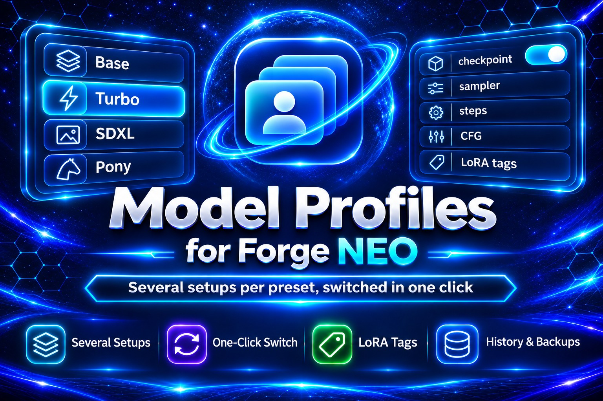

<p align="center">
  
</p>

# 🎚️ Model Profiles for Forge Neo

<div align="center">

[](https://github.com/Haoming02/sd-webui-forge-classic/tree/neo)
[](https://gradio.app/)
[](https://github.com/eduardoabreu81/sd-model-profiles-neo)
[](LICENSE)

> **Extension for [Stable Diffusion WebUI Forge - Neo](https://github.com/Haoming02/sd-webui-forge-classic/tree/neo)**

</div>

Keep **several setups for the same UI Preset** - Qwen-Image 2.1 *Base* and *Turbo*, SDXL and Pony, a fast draft and a final pass - and switch between them in one click. A profile holds what Forge's preset holds: **checkpoint, VAE / Text Encoder, Diffusion in Low Bits, sampler, schedule type, steps, CFG, Shift / Distilled CFG, Hires. steps and CFG**, for txt2img and img2img. The image size stays yours: switching profiles never changes it.

> [!Important]
> Model Profiles builds on Forge Neo's own **UI Preset** settings (Settings > presets) and selects model files through Forge's own functions. Nothing of Forge Neo is changed, and generation is never touched.

---

## ✨ Features

- **One dropdown** on its own row under the model row, listing the profiles of the preset on screen: the ones of the checkpoint in use first, then the preset's, the ones for every preset, the preset's other checkpoints, and the suggestions
- **💾 Save** updates the profile you are using; otherwise it asks for a name and **where the profile applies**:
  - **This checkpoint** - keeps the checkpoint, VAE / Text Encoder and Low Bits, and is applied by itself when you choose that checkpoint in Forge's list (*krea2-4step*)
  - **This preset** - settings only, on top of any checkpoint of the preset (*MOSS normal*, *MOSS turbo*)
  - **Every preset** - steps, CFG, sampler and prompt tokens, listed in every preset (*Draft 4 steps*); Shift / Distilled CFG stay out, since they mean different things per preset
- **⋯** - save as a new profile, set or remove the **★ default**, change where a profile applies, rename, delete
- **★ Default per preset** - leaving a preset puts its starred profile back, so every visit starts from it while the others stay one click away. No star, no change: Forge behaves as before
- **Suggestions** - **Forge default** (the factory values of every preset, including the ones added by model extensions) and any `model_profiles.json` shipped by an extension
- **Prompt tokens / LoRA** - a profile can add words to the prompt and the negative prompt, such as the LoRA a *Turbo* needs; switching to another profile or preset removes exactly what it added, and a tag you edited (another weight) is left alone
- **History** - every time a preset's settings are overwritten, and every time a profile is saved over or deleted, the previous version is recorded; restore any of the last entries from **⋯ > History**
- **Backups** - a daily copy of Forge's `config.json` before the extension writes to it, and of the profiles file, in `model_profiles_backups/` (14 days); the profiles file also keeps its previous version as `model_profiles.json.bak`
- **Export / Import** - share your profiles of a preset as a file; the file uses the same format as the suggestion files below
- **"modified" mark** when the controls no longer match the profile
- **Generation parameters** - `Profile: Turbo 8 steps` (or `(modified)`); *Send to txt2img* and *PNG Info* bring the profile back to the dropdown
- **Safe with model extensions** - presets added at runtime (Qwen-Image 2.1, MiniMax-H3, LTX, MOSS-Image, ...) get their profiles too, and when an extension's panel changes the sampler or steps on a checkpoint switch, the profile's values are applied again
- **Nothing lost** - the first time a preset is written, its current Settings values are kept as the profile *My Forge preset* if you had changed them

## 📦 Installation

1. In Forge Neo, open **Extensions > Install from URL**
2. Paste `https://github.com/eduardoabreu81/sd-model-profiles-neo` and click **Install**
3. Restart Forge Neo

## 🛠️ How to Use

1. Pick a **UI Preset** as usual
2. Set the checkpoint, sampler, steps and the rest the way this model wants them
3. Click **💾**, name the profile (*Turbo 8 steps*) and choose where it applies: this checkpoint, this preset or every preset
4. Set up the other variant and save it too (*Base 20 steps*)
5. Switch with the **Profile** dropdown - or, for checkpoint profiles, just choose the checkpoint; mark the one you use most with **⋯ > ★ Set as default**
6. If the Turbo needs a LoRA, select it and use **⋯ > Prompt tokens / LoRA** (`<lora:name:1>`)

The image size is never part of a profile saved from the screen: switching profiles leaves width and height as they are.

Profiles are kept in `model_profiles.json` in Forge's data folder (next to `styles.csv`), with the history in `model_profiles_history.json` and the backups in `model_profiles_backups/`, so updating the extension never touches them. Profiles of a preset whose extension is turned off stay there and come back with it.

### Settings

**Settings > presets > Model Profiles**

| Option | Default |
| --- | --- |
| Leaving a UI Preset puts its ★ default profile back into it | on |
| Choosing a checkpoint in the list applies its checkpoint profile | on |
| Write the profile name to the generation parameters | on |

## 🧩 Suggestions from Extensions

Any extension can suggest settings for its model: put a `model_profiles.json` in the extension's folder. Without Model Profiles installed, the file is simply ignored.

```json
{
  "version": 1,
  "profiles": [
    {"preset": "qwen21", "name": "Base", "values": {"sampler": "Euler", "scheduler": "Simple", "steps": 20, "cfg": 2.5}},
    {"preset": "qwen21", "name": "Turbo", "values": {"scheduler": "Viggle Turbo", "steps": 8, "cfg": 1}},
    {"preset": "h3i", "name": "LCM 6 steps", "values": {"sampler": "LCM", "scheduler": "Simple", "steps": 6, "cfg": 1,
                                                        "img2img": {"steps": 8}}}
  ]
}
```

- `preset` is the UI Preset name (`xl`, `flux`, `qwen21`, or one an extension adds), or `*` for every preset
- top-level settings apply to txt2img and img2img; `txt2img` / `img2img` objects override them
- settings: `sampler`, `scheduler`, `steps`, `cfg`, `shift` (or `distilled_cfg`), and for txt2img `hr_steps`, `hr_cfg`, `hr_shift`; `width` and `height` too, for a model that needs a size of its own (profiles saved from the screen leave the size out)
- model files: `checkpoint`, `modules` (list of file names), `dtype`
- prompt tokens: `prompt` and `negative_prompt` (text with commas, or a list), such as a LoRA tag
- anything left out keeps its current value, so a suggestion can change only the sampler and steps
- a sampler, schedule or file that is not installed is skipped with a warning; the rest is applied

## 🙏 Credits

- [Forge Neo](https://github.com/Haoming02/sd-webui-forge-classic/tree/neo) by Haoming02, whose per-preset settings this builds on
- The idea came from [Haoming02/sd-webui-forge-classic#1636](https://github.com/Haoming02/sd-webui-forge-classic/issues/1636)
- [sd-aspect-ratio-plus](https://github.com/anxety-solo/sd-aspect-ratio-plus) for the "one click, no clutter" spirit

---

<div align="center">

Made with ❤️ for the Stable Diffusion community

**[Report Bug](https://github.com/eduardoabreu81/sd-model-profiles-neo/issues)** • **[Request Feature](https://github.com/eduardoabreu81/sd-model-profiles-neo/issues)** • **[☕ Ko-fi](https://ko-fi.com/eduardoabreu81)**

<sub>More Forge Neo extensions at <a href="https://eduardoabreu81.github.io/">eduardoabreu81.github.io</a></sub>

</div>
